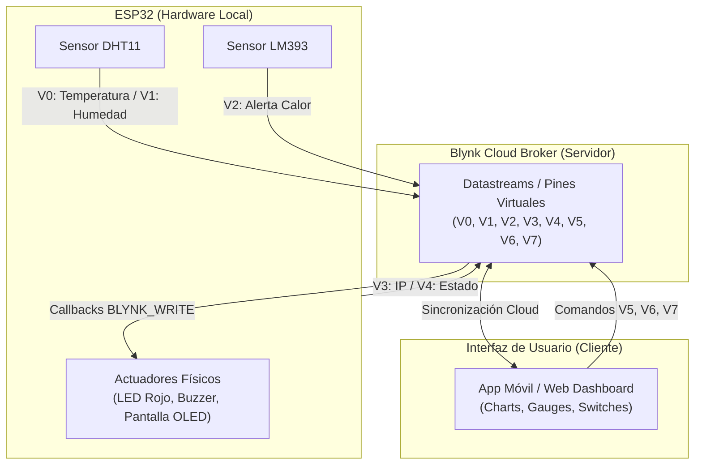
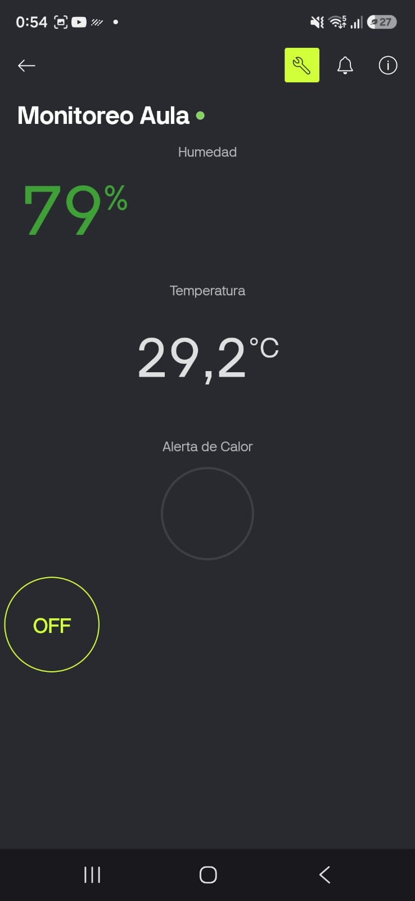
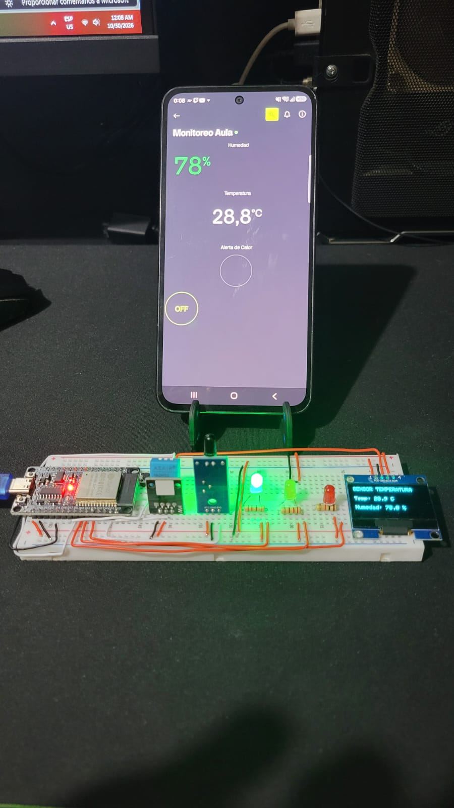

# Sistema IoT de Monitoreo Ambiental, Control Bidireccional y Alerta de Incendios

**Asignatura:** IoT (Internet de las Cosas)  
**Institución:** Unidades Tecnológicas de Santander (UTS)  
**Estudiante:** Juan Esteban Cárdenas López  
**Profesor:** Eliecer Montero  

---

# 📌 PARTE 1: DOCUMENTACIÓN Y DESARROLLO - SEMANA 12

## 📌 Descripción del Proyecto (Semana 12)

Este proyecto implementa un sistema IoT bidireccional que recopila datos ambientales en tiempo real (Temperatura, Humedad y Alerta de Calor) mediante un microcontrolador **ESP32** y los transmite a la plataforma en la nube **Blynk IoT**. 

Adicionalmente, el sistema permite el **control remoto de actuadores** (LED Rojo, Buzzer sonoro y navegación en pantalla OLED SH1106) desde una aplicación móvil o un dashboard web, garantizando alta disponibilidad, baja latencia y reconexión automática mediante un portal cautivo WiFi (*WiFiManager*).

---

## 🏗️ Diagrama de Arquitectura

El flujo de información entre el hardware físico, la nube y los paneles de usuario se sintetiza en el siguiente esquema UML:



---

## 📋 Asignación de Pines Virtuales (Datastreams)

| Pin Virtual | Tipo de Dato | Dirección | Descripción / Componente Asociado |
| :--- | :--- | :--- | :--- |
| **V0** | Double / Float | ESP32 $\rightarrow$ Cloud | Lectura de Temperatura (°C) - Sensor DHT11 |
| **V1** | Double / Float | ESP32 $\rightarrow$ Cloud | Lectura de Humedad (%) - Sensor DHT11 |
| **V2** | Integer (0/1) | ESP32 $\rightarrow$ Cloud | Alerta de Calor / Radiación (0 = Normal, 1 = Calor) - LM393 |
| **V3** | String | ESP32 $\rightarrow$ Cloud | Dirección IP asignada en la red local |
| **V4** | String | ESP32 $\rightarrow$ Cloud | Estado de la conexión a Blynk Cloud |
| **V5** | Integer (0/1) | Cloud $\rightarrow$ ESP32 | Interruptor de control remoto para el **LED Rojo** |
| **V6** | Integer (0/1) | Cloud $\rightarrow$ ESP32 | Interruptor de control remoto para el **Buzzer** |
| **V7** | Integer (0/1) | Cloud $\rightarrow$ ESP32 | Botón virtual para **Rotar Pantalla OLED** |

---

## 🔌 Esquema de Conexiones de Hardware

Realiza las conexiones en la protoboard según la siguiente tabla de asignación de pines GPIO del ESP32:

| Componente | Pin del Componente | GPIO ESP32 |
| :--- | :--- | :--- |
| **DHT11** | DATA / OUT | `GPIO 23` |
| **LM393 (Calor)** | DO (Digital Out) | `GPIO 22` |
| **OLED SH1106** | SDA / SCL | `GPIO 4` (SDA) / `GPIO 5` (SCL) |
| **Push Button** | Pin Físico | `GPIO 17` (INPUT_PULLUP interno) |
| **LED Rojo** | Ánodo (+) | `GPIO 18` |
| **LED Amarillo** | Ánodo (+) | `GPIO 19` |
| **LED Verde** | Ánodo (+) | `GPIO 21` |
| **Buzzer Activo** | Positivo (+) | `GPIO 16` |

---

## 🚀 Instrucciones para Replicar el Proyecto

Sigue estos pasos en orden para montar y ejecutar el proyecto desde cero en cualquier entorno:

### Paso 1: Configuración de la Plataforma Cloud (Blynk IoT)

1. Ingresa a [blynk.cloud](https://blynk.cloud/) e inicia sesión con tu cuenta.
2. Ve a **Developer Zone** ➔ **Templates** ➔ **Create New Template**:
   * **Nombre:** `Alarma`
   * **Hardware:** `ESP32`
   * **Connection Type:** `WiFi`
3. Ve a la pestaña **Datastreams** y crea los 8 Pines Virtuales (`V0` a `V7`) según la tabla de asignación.
4. Ve a la pestaña **Web Dashboard** (o en la App Móvil) y arrastra los widgets:
   * **History Chart** ➔ Vinculado a `V0` (Temperatura).
   * **Gauge / Value Display** ➔ Vinculado a `V1` (Humedad).
   * **LED Widget / Color Block** ➔ Vinculado a `V2` (Calor).
   * **Switch** ➔ Vinculado a `V5` (LED Rojo).
   * **Switch** ➔ Vinculado a `V6` (Buzzer).
   * **Button (Modo PUSH)** ➔ Vinculado a `V7` (Navegación OLED).
   * **Labels / Text** ➔ Vinculados a `V3` (IP) y `V4` (Estado).
5. Ve a **Search** ➔ **Devices** ➔ **New Device** ➔ **From Template** y selecciona `Alarma`.
6. En la pestaña **Device Info**, copia las 3 líneas con el `BLYNK_TEMPLATE_ID`, `BLYNK_TEMPLATE_NAME` y `BLYNK_AUTH_TOKEN`.

---

### Paso 2: Configuración del Entorno en Arduino IDE

1. Abre el **Arduino IDE** e instala el soporte para placas ESP32 desde el *Board Manager*.
2. Ve a **Herramientas** ➔ **Administrar Bibliotecas** e instala las siguientes librerías:
   * `WiFiManager` (por tzapu)
   * `Blynk` (por Volodymyr Shymanskyy)
   * `DHT sensor library` (por Adafruit)
   * `Adafruit SH110X` y `Adafruit GFX Library`
3. Abre el archivo del proyecto `PROYECTOIOT.ino`.
4. En las primeras líneas del código, reemplaza las constantes con el Token de tu dispositivo obtenido en el Paso 1:
   ```cpp
   #define BLYNK_TEMPLATE_ID   "TMPL2YN-F-M4y"
   #define BLYNK_TEMPLATE_NAME "Alarma"
   #define BLYNK_AUTH_TOKEN    "UtYj3HhSHoIrAXDtISwUVzEYqyDhH0ex"
   ```
5. Conecta el ESP32 a la PC mediante USB, selecciona la placa **ESP32 Dev Module**, escoge el puerto COM correspondiente y presiona **Subir** (Upload).

---

### Paso 3: Puesta en Marcha y Conexión de Red

1. Una vez grabado el programa, el ESP32 encenderá el **LED Amarillo** e iniciará la red WiFi de configuración llamada **`Alarma-Aula-Juanes`**.
2. Desde tu teléfono celular o PC, conéctate a la red WiFi **`Alarma-Aula-Juanes`**.
3. Se abrirá automáticamente el portal cautivo de *WiFiManager* (si no abre, ingresa desde el navegador a la IP `192.168.4.1`).
4. Selecciona **Configure WiFi**, busca la red WiFi de tu aula/hogar, ingresa la clave de red y presiona **Save**.
5. El ESP32 guardará los datos, se conectará a la red local, encenderá el **LED Verde** y pasará al estado **Online** en la consola de Blynk.

---

### Paso 4: Pruebas de Verificación

* **Telemetría:** Comprueba que los valores de temperatura y humedad se muestren en tiempo real en los widgets de la app.
* **Sensor de Calor:** Acerca una fuente de calor al sensor LM393 y verifica que el indicador cambie de `0` a `1` al instante.
* **Control Remoto:** Presiona los botones virtuales `V5` (LED Rojo), `V6` (Buzzer) y `V7` (Rotar OLED) desde tu celular y confirma la activación inmediata de los componentes físicos en el ESP32.

---

## 🧪 Pruebas de Integración y Resultados (Fase 3 y 4)

Se diseñó una interfaz móvil e hiperconectada orientada a la operación en tiempo real. La transmisión de eventos críticos (detección de calor con LM393) se ejecuta mediante la interrupción por cambio de estado, enviando inmediatamente la señal a Blynk sin depender del ciclo de muestreo.

* **PRUEBA 1: TELEMETRÍA Y PUBLICACIÓN**  
  **Resultado:** Exitoso. Las variables de humedad y temperatura se actualizan cada 2.5 segundos en la aplicación. El gráfico histórico (*History Chart*) almacena los registros sin pérdida de paquetes.

* **PRUEBA 2: CONTROL BIDIRECCIONAL**  
  **Resultado:** Exitoso. La activación de los switches para V5 (LED) y V6 (Buzzer) conmuta los pines físicos del ESP32 en menos de 150 ms. El botón virtual V7 rota la pantalla OLED en sincronía con el pulsador físico.

* **PRUEBA 3: SENSÓRICA INMEDIATA**  
  **Resultado:** Exitoso. Al acercar calor al LM393, la transición 0 $\rightarrow$ 1 conmuta instantáneamente en la aplicación y activa el indicador de alerta sin sufrir sofocamiento (*Rate Limit*).

* **PRUEBA 4: RESILIENCIA DE RED**  
  **Resultado:** Exitoso. Al desconectar la alimentación o apagar el router Wi-Fi, la app marca el estado Offline. Al restaurar la energía, WiFiManager y Blynk.config() reconectan automáticamente.

---

## 📸 Evidencias de Funcionamiento (Semana 12)

### Demostración en Video
Puedes visualizar la demostración completa de control bidireccional y prueba de sensores en el siguiente enlace:

🎥 **[Ver Video de Demostración (MP4)](./desarrollo%20proyecto%20semana%2012/video_demostracion.mp4)**
> 📽️ **Nota:** El video completo con las pruebas de funcionamiento se encuentra adjunto localmente en la carpeta `/desarrollo proyecto semana 12/` del archivo comprimido del proyecto.

### Captura del Dashboard de Blynk


### Foto del Circuito Físico del Proyecto


---

# 📌 PARTE 2: DOCUMENTACIÓN Y ENTREGA EN GITHUB - SEMANA 13

## 🚨 Sistema de Monitoreo de Alerta de Calor e Incendios IoT (ESP32)

## 📌 Descripción del Proyecto (Semana 13 - Fase 5)
Este proyecto consiste en un sistema de monitoreo ambiental y prevención de emergencias desarrollado para el aula de clases. Utiliza una placa **ESP32** para capturar variables térmicas mediante un sensor de temperatura/humedad **DHT11** y un sensor de radiación/calor **LM393**. 

El sistema cuenta con interfaz local en una pantalla **OLED SH1106**, semáforo LED de estado, navegación por botón físico y conexión IoT nativa a la plataforma **Blynk IoT**, la cual activa notificaciones push instantáneas en dispositivos móviles al detectar umbrales críticos de calor.

---

## 📐 Diagrama de Conexiones (Pinout ESP32)

| Componente | Pin del Componente | GPIO del ESP32 | Función / Descripción |
| :--- | :--- | :--- | :--- |
| **DHT11** | Data | `GPIO 23` | Lectura de Temperatura y Humedad |
| **LM393** | Out (Digital) | `GPIO 22` | Detección Digital de Calor / Fuego |
| **Botón Físico** | Pin de Señal | `GPIO 17` | Navegación entre vistas OLED (Pull-up) |
| **LED Rojo** | Ánodo (+) | `GPIO 18` | Indicador visual de Alerta / Fuego |
| **LED Amarillo** | Ánodo (+) | `GPIO 19` | Indicador de Estado / Conectando |
| **LED Verde** | Ánodo (+) | `GPIO 21` | Indicador de Estado Normal / Conectado |
| **Buzzer** | Ánodo (+) | `GPIO 16` | Alarma sonora remota/local |
| **OLED SH1106** | SDA | `GPIO 4` | Bus de datos I2C pantalla |
| **OLED SH1106** | SCL | `GPIO 5` | Bus de reloj I2C pantalla |

---

## 🔄 Explicación del Flujo de Datos

```
[ Sensor LM393 ] ──(Lectura LOW)──> [ ESP32 Dev Module ]
                                            │
                                  (Procesamiento no bloqueante)
                                            │
                                            ├──> [ Pantalla OLED SH1106 / Semáforo LED ]
                                            │
                                            └──(Blynk.logEvent)──> [ Blynk IoT Cloud ]
                                                                        │
                                                                   (Push Directo)
                                                                        │
                                                                        ▼
                                                             [ Smartphone del Usuario ]
```

1. **Captura:** El sensor LM393 detecta la presencia de radiación infrarroja/calor y envía un estado lógico `LOW` (`0`) al `GPIO 22` del ESP32.
2. **Procesamiento:** El ESP32 cambia el semáforo LED a rojo y actualiza la pantalla OLED con la alerta en tiempo real sin bloquear el loop principal (`millis()`).
3. **Transmisión:** Se envía la actualización del pin virtual `V2` y se dispara el evento `"alerta_calor"` mediante la librería oficial de Blynk IoT.
4. **Notificación:** La nube de Blynk evalúa la regla del evento e instantáneamente envía una notificación push prioritaria a la aplicación móvil en el teléfono.

---

## 🖼️ Evidencias de Funcionamiento (Semana 13)

> **Nota:** Las imágenes a continuación corresponden a las capturas almacenadas en la carpeta `evidencias/`.

### Configuración del Evento y Panel Blynk


### Notificación Push Recibida en Smartphone (Vista 1)


### Notificación Push Recibida en Smartphone (Vista 2)


---

## 💻 Código Fuente Principal (`PROYECTOIOT.ino`)

```cpp
// ==========================================
// IMPORTACIÓN DE CREDENCIALES DESDE config.h
// ==========================================
#include "config.h"

#define BLYNK_PRINT Serial

#include <WiFi.h>
#include <WebServer.h>
#include <DNSServer.h>
#include <WiFiManager.h>      // Portal Cautivo
#include <BlynkSimpleEsp32.h> // Blynk para ESP32
#include <DHT.h>              // Sensor Temp/Hum
#include <Wire.h>
#include <Adafruit_GFX.h>
#include <Adafruit_SH110X.h>  // OLED SH1106

// ==========================================
// DEFINICIÓN DE PINES (GPIOs)
// ==========================================
#define DHTPIN          23
#define DHTTYPE         DHT11
#define SENSOR_CALOR    22
#define BOTON_PIN       17
#define LED_ROJO        18
#define LED_AMARILLO    19
#define LED_VERDE       21
#define BUZZER_PIN      16

// ==========================================
// OBJETOS GLOBALES Y VARIABLES
// ==========================================
DHT dht(DHTPIN, DHTTYPE);
BlynkTimer timer;

#define SCREEN_WIDTH 128
#define SCREEN_HEIGHT 64
#define OLED_RESET -1
Adafruit_SH1106G display = Adafruit_SH1106G(SCREEN_WIDTH, SCREEN_HEIGHT, &Wire, OLED_RESET);

unsigned long lastOled = 0;
int vistaOled = 1;             
bool ultimoEstadoBoton = HIGH;
bool ultimoEstadoFuego = false;

// Prototipos
void enviarTelemetriaBlynk();
void actualizarPantalla(bool fuego, float temp, float hum);

void setup() {
  Serial.begin(115200);
  Wire.begin(4, 5); // SDA = GPIO4, SCL = GPIO5

  pinMode(SENSOR_CALOR, INPUT);
  pinMode(BOTON_PIN, INPUT_PULLUP);
  pinMode(LED_ROJO, OUTPUT);
  pinMode(LED_AMARILLO, OUTPUT);
  pinMode(LED_VERDE, OUTPUT);
  pinMode(BUZZER_PIN, OUTPUT);

  digitalWrite(LED_ROJO, LOW);
  digitalWrite(LED_AMARILLO, HIGH); // Amarillo = Conectando
  digitalWrite(LED_VERDE, LOW);
  digitalWrite(BUZZER_PIN, LOW);

  // Inicializar Pantalla OLED SH1106
  if (!display.begin(0x3C, true)) {
    Serial.println("Error al iniciar OLED SH1106");
  }
  display.clearDisplay();
  display.setTextColor(SH110X_WHITE);
  display.setTextSize(1);
  display.setCursor(0, 2);
  display.println("MONITOREO AULA - BLYNK");
  display.setCursor(0, 22);
  display.println("Conectando a red...");
  display.display();

  dht.begin();

  // Configuración de red WiFiManager
  WiFi.mode(WIFI_STA);
  WiFi.setAutoReconnect(true); 
  WiFi.setSleep(false);

  WiFiManager wm;
  if (!wm.autoConnect("Alarma-Aula-Juanes")) {
    Serial.println("Tiempo agotado. Reiniciando...");
    ESP.restart();
  }

  digitalWrite(LED_AMARILLO, LOW);
  digitalWrite(LED_VERDE, HIGH);

  // Configurar Blynk usando las credenciales importadas de config.h
  Blynk.config(BLYNK_AUTH_TOKEN);

  // Envío periódico de telemetría cada 2.5 segundos
  timer.setInterval(2500L, enviarTelemetriaBlynk);
}

void loop() {
  if (WiFi.status() == WL_CONNECTED) {
    Blynk.run();
  }
  timer.run();

  unsigned long now = millis();

  // 1. Detección del sensor de calor LM393 (LOW = Fuego/Calor)
  bool estadoFuegoActual = (digitalRead(SENSOR_CALOR) == LOW);

  if (estadoFuegoActual) {
    digitalWrite(LED_ROJO, HIGH);
    digitalWrite(LED_VERDE, LOW);
  } else {
    digitalWrite(LED_ROJO, LOW);
    if (WiFi.status() == WL_CONNECTED) {
      digitalWrite(LED_VERDE, HIGH);
      digitalWrite(LED_AMARILLO, LOW);
    }
  }

  // 2. Transmisión a Blynk y Disparo de Notificación PUSH Personalizada
  if (estadoFuegoActual != ultimoEstadoFuego) {
    ultimoEstadoFuego = estadoFuegoActual;
    
    // Actualizar el estado en el datastream V2
    Blynk.virtualWrite(V2, estadoFuegoActual ? 1 : 0);

    // Si se activa el sensor de calor, envía el evento con mensaje y emojis
    if (estadoFuegoActual) {
      Blynk.logEvent("alerta_calor", "🚨🔥 ALERTA DE CALOR ⚠️‼️ Por favor revisar el espacio antes de que se genere un incendio 👨‍🚒🧯💨");
    }
    
    Serial.print("Blynk enviado -> Calor: ");
    Serial.println(estadoFuegoActual ? 1 : 0);
  }

  // 3. Navegación en Pantalla OLED mediante Botón Físico
  bool lecturaBoton = digitalRead(BOTON_PIN);
  if (lecturaBoton == LOW && ultimoEstadoBoton == HIGH) {
    vistaOled++;
    if (vistaOled > 3) vistaOled = 1;
    delay(30); 
  }
  ultimoEstadoBoton = lecturaBoton;

  // 4. Refresco fluido de la Pantalla OLED (cada 100 ms)
  if (now - lastOled > 100) {
    lastOled = now;
    float temp = dht.readTemperature();
    float hum = dht.readHumidity();
    actualizarPantalla(estadoFuegoActual, temp, hum);
  }
}

// Switches y control remoto desde la app de Blynk
BLYNK_WRITE(V5) { 
  int val = param.asInt();
  digitalWrite(LED_ROJO, val ? HIGH : LOW);
}

BLYNK_WRITE(V6) { 
  int val = param.asInt();
  digitalWrite(BUZZER_PIN, val ? HIGH : LOW);
}

BLYNK_WRITE(V7) { 
  int val = param.asInt();
  if (val == 1) { 
    vistaOled++;
    if (vistaOled > 3) vistaOled = 1;
  }
}

// Envío continuo de telemetría DHT11
void enviarTelemetriaBlynk() {
  float temp = dht.readTemperature();
  float hum = dht.readHumidity();

  if (!isnan(temp)) Blynk.virtualWrite(V0, temp);
  if (!isnan(hum))  Blynk.virtualWrite(V1, hum);

  if (Blynk.connected()) {
    Blynk.virtualWrite(V3, WiFi.localIP().toString());
    Blynk.virtualWrite(V4, "Conectado a Blynk");
  }
}

// Sincronizar estado al reconectar
BLYNK_CONNECTED() {
  Blynk.virtualWrite(V3, WiFi.localIP().toString());
  Blynk.virtualWrite(V4, "Conectado a Blynk");
  Blynk.virtualWrite(V2, ultimoEstadoFuego ? 1 : 0);
}

// Función de interfaz para la pantalla OLED SH1106
void actualizarPantalla(bool fuego, float temp, float hum) {
  display.clearDisplay();
  display.setTextColor(SH110X_WHITE);
  display.setTextSize(1);

  if (vistaOled == 1) {
    display.setCursor(0, 2);
    display.println("MONITOREO CON BLYNK");

    display.setCursor(0, 18);
    display.print("WiFi: ");
    display.println(WiFi.status() == WL_CONNECTED ? WiFi.SSID() : "Reconectando");

    display.setCursor(0, 34);
    display.print("IP: ");
    display.println(WiFi.status() == WL_CONNECTED ? WiFi.localIP().toString() : "0.0.0.0");

    display.setCursor(0, 50);
    display.print("Blynk: ");
    display.println(Blynk.connected() ? "Conectado" : "Desconectado");

  } else if (vistaOled == 2) {
    display.setCursor(0, 2);
    display.println("SENSOR TEMPERATURA");

    display.setCursor(0, 24);
    display.print("Temp: ");
    display.print(isnan(temp) ? 0.0 : temp, 1);
    display.println(" C");

    display.setCursor(0, 44);
    display.print("Humedad: ");
    display.print(isnan(hum) ? 0.0 : hum, 1);
    display.println(" %");

  } else if (vistaOled == 3) {
    display.setCursor(0, 2);
    display.println("SENSOR DE CALOR");

    display.setCursor(0, 24);
    display.print("Estado: ");
    if (fuego) {
      display.println("!! CALOR !!");
      display.setCursor(0, 44);
      display.println("Alerta Activada");
    } else {
      display.println("NORMAL");
      display.setCursor(0, 44);
      display.println("Sin radiacion");
    }
  }

  display.display();
}
```

---

## 📝 Conclusiones sobre la Utilidad de la Automatización en IoT

1. **Reducción de Tiempos de Respuesta:** La implementación de notificaciones push automatizadas a través de plataformas IoT elimina la necesidad de supervisión humana constante, reduciendo los tiempos de reacción ante eventos críticos como incendios o fluctuaciones de temperatura extrema.
2. **Arquitecturas Eficientes y Escalables:** El uso de bibliotecas optimizadas y patrones no bloqueantes (`millis()`) en microcontroladores como el ESP32 permite mantener la estabilidad del hardware local mientras se gestiona la transmisión de datos a la nube de manera simultánea.
3. **Integración Multicapa:** Integrar monitoreo visual local (pantallas OLED/semáforos) junto con alertas remotas en la nube asegura redundancia operativa, lo cual es fundamental para sistemas de seguridad e infraestructura inteligente en aulas o industrias.