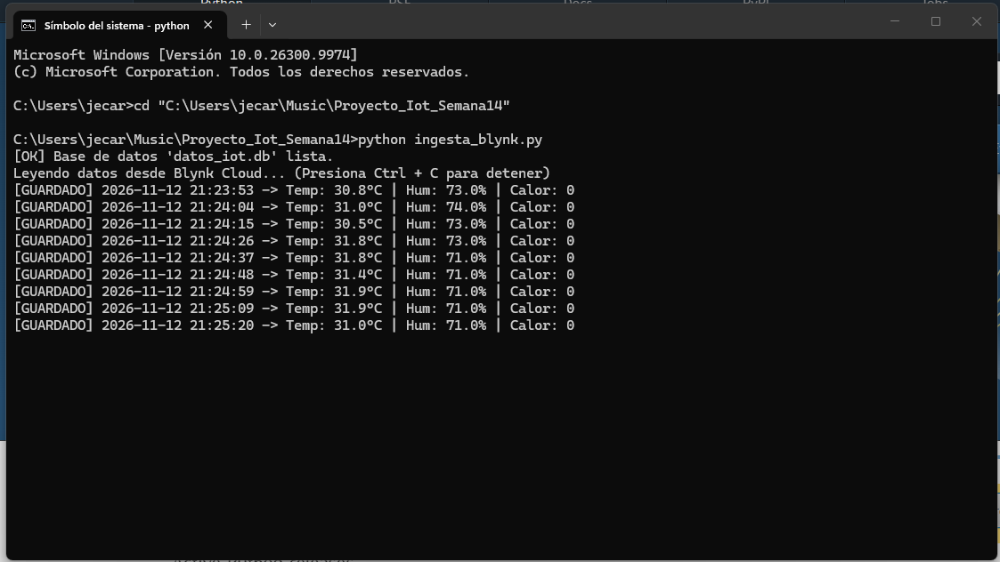
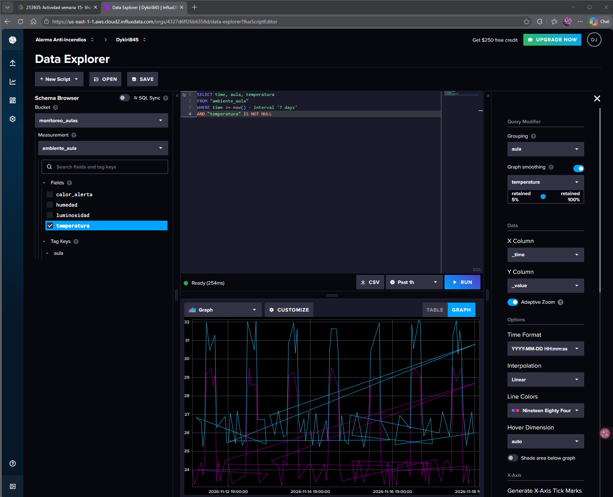
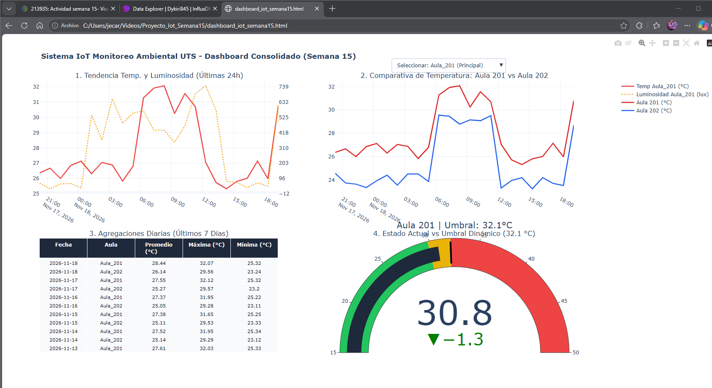
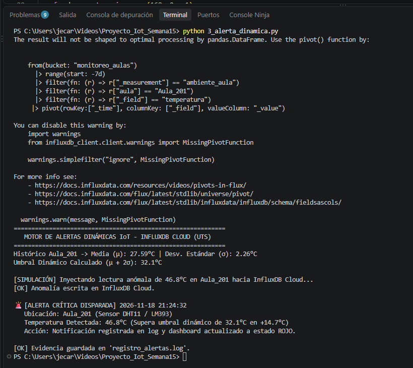
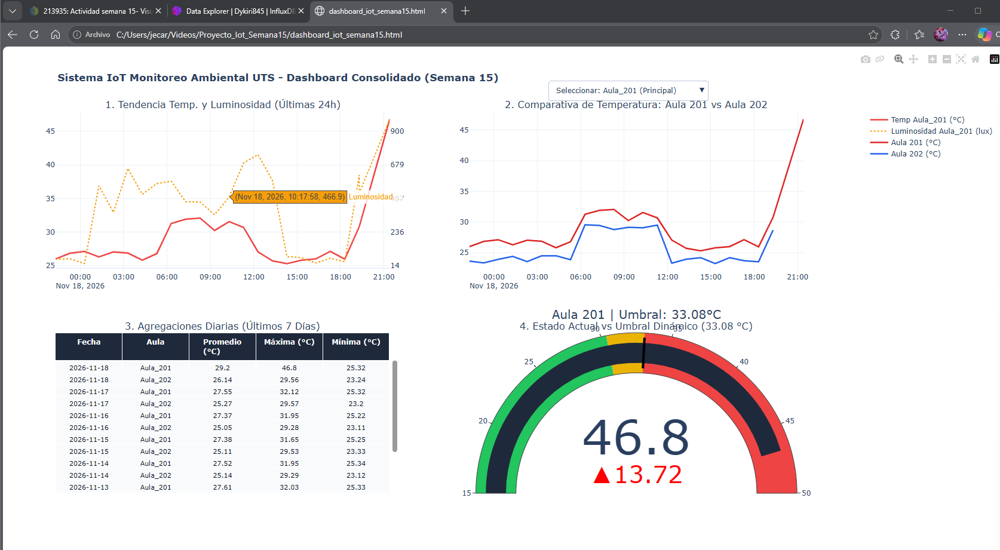
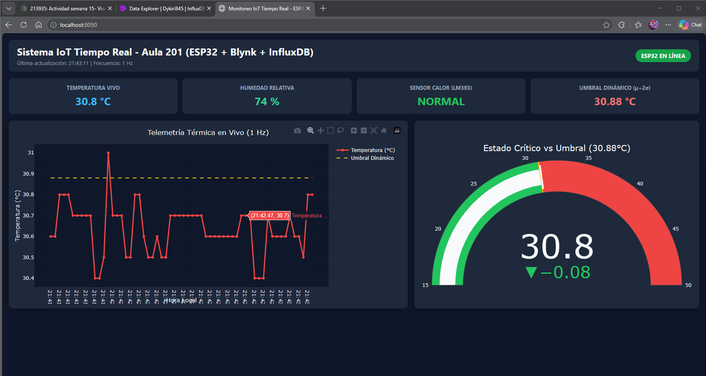
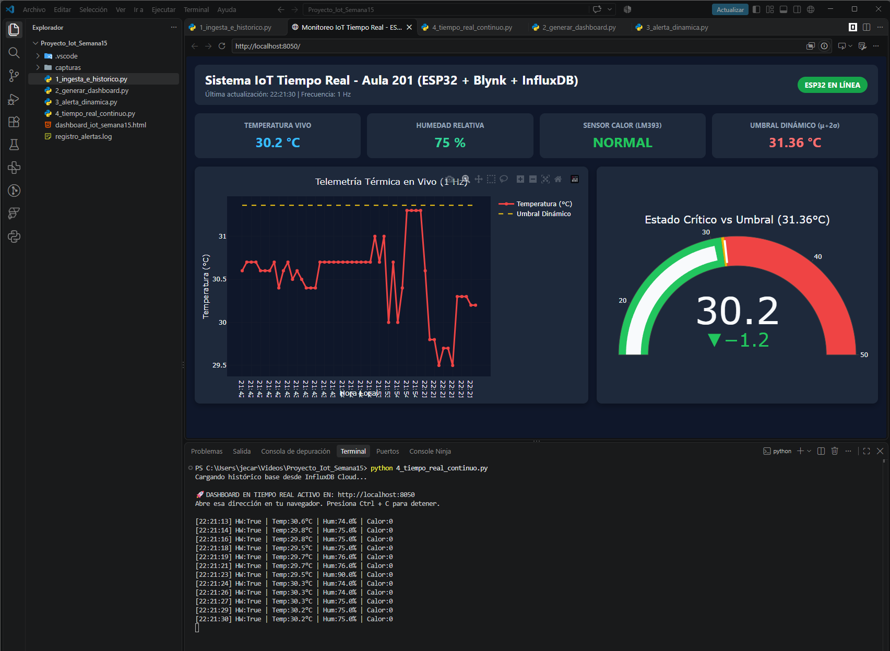

# 🌐 Sistema de Monitoreo Ambiental IoT, Persistencia y Analítica en la Nube

Este proyecto consiste en un sistema integral de telemetría IoT para la medición, almacenamiento, visualización avanzada y detección de anomalías de variables ambientales (temperatura, humedad, luminosidad e indicador de calor) utilizando microcontroladores **ESP32**, **Blynk Cloud**, persistencia local en **SQLite**, bases de datos de series temporales en **InfluxDB Cloud** y dashboards interactivos en **Python (Plotly)** con actualización en tiempo real a **1 Hz**.

---

## 📋 Tabla de Contenidos

* [📌 PARTE 1: Configuración Hardware y Conectividad IoT (Semana 12)](#-parte-1-configuración-hardware-y-conectividad-iot---semana-12)
* [📌 PARTE 2: Integración Blynk Cloud y Dashboard (Semana 13)](#-parte-2-integración-blynk-cloud-y-dashboard---semana-13)
* [📌 PARTE 3: Almacenamiento Avanzado y Persistencia Local (Semana 14)](#-parte-3-almacenamiento-avanzado-y-persistencia-local---semana-14)
* [📌 PARTE 4: Series Temporales en la Nube, Dashboards y Alertas Dinámicas (Semana 15)](#-parte-4-series-temporales-en-la-nube-dashboards-y-alertas-dinámicas---semana-15)
* [🛠️ Requisitos e Instalación (Semana 15)](#️-requisitos-e-instalación-semana-15)
* [📷 Evidencias del Sistema (Semana 15)](#-evidencias-del-sistema-semana-15)

---

# 📌 PARTE 1: CONFIGURACIÓN HARDWARE Y CONECTIVIDAD IOT - SEMANA 12

## 🛠️ Componentes Utilizados

* **Microcontrolador:** ESP32 con módulo Wi-Fi integrado (`WiFiManager` AP: `Alarma-Aula-Juanes`).
* **Sensor de Temperatura y Humedad:** DHT11 (`Pin V0` / `Pin V1`).
* **Sensor de Detección de Calor:** LM393 o módulo digital equivalente (`Pin V2`).
* **Plataforma IoT:** Blynk IoT Cloud.

## 📐 Pines Virtuales Configurados

* `V0`: Temperatura (°C)
* `V1`: Humedad (%)
* `V2`: Estado de Calor (0 / 1)

---

# 📌 PARTE 2: INTEGRACIÓN BLYNK CLOUD Y DASHBOARD - SEMANA 13

## ☁️ Configuración en Blynk Cloud

Se configuró un Dashboard Web en **Blynk.console** con los siguientes widgets:

* **Gauge / Display Numérico:** Lectura de Temperatura en tiempo real (`V0`).
* **Gauge / Display Numérico:** Lectura de Humedad en tiempo real (`V1`).
* **LED / Indicator Status:** Alerta visual de alta temperatura / calor (`V2`).

## 📡 API REST de Blynk

El sistema utiliza la API pública de Blynk para consulta remota y extracción masiva de pines mediante peticiones HTTP GET:

```text
https://blynk.cloud/external/api/get?token=TU_TOKEN&V0&V1&V2
```

---

# 📌 PARTE 3: ALMACENAMIENTO AVANZADO Y PERSISTENCIA LOCAL - SEMANA 14

## 📌 Descripción del Proyecto (Semana 14)

En esta fase se extiende la arquitectura del sistema de monitoreo ambiental mediante la implementación de una capa de **almacenamiento avanzado y persistencia local**. Dado que el plan gratuito de **Blynk Cloud** limita el historial de datos a **24 horas**, se desarrolló una solución híbrida utilizando **Python** y **SQLite** (`datos_iot.db`).

El sistema extrae en tiempo real los valores de los pines virtuales (`V0`, `V1` y `V2`) mediante la API REST de Blynk en una única petición HTTP consolidada cada segundo, almacenándolos en disco duro con marca de tiempo exacta (`timestamp`). Esto garantiza retención ilimitada, independencia ante caídas de red tras la captura y capacidad de ejecutar consultas SQL analíticas.

## 🔄 Arquitectura de Persistencia Local

```text
[ Blynk Cloud REST API ] ──(GET /external/api/get?V0&V1&V2)──> [ ingesta_blynk.py ]
                                                                       │
                                                            (Inserción cada 1 seg)
                                                                       │
                                                                       ▼
[ Reportes Estadísticos ] <──(Consultas SQL: AVG/MAX/MIN)── [ datos_iot.db (SQLite) ]
       ▲                                                               │
       └────────────────────── [ verificar_datos.py ] ─────────────────┘
                            (Auditoría tras reinicio del PC)
```

## 🗄️ Esquema de Base de Datos (`datos_iot.db`)

Los registros recopilados se almacenan en la tabla relacional `historial_sensores` bajo la siguiente estructura:

| Campo | Tipo SQL | Restricción | Descripción | 
| :--- | :--- | :--- | :--- | 
| `id` | `INTEGER` | `PRIMARY KEY AUTOINCREMENT` | Identificador único y secuencial de cada lectura. | 
| `fecha_hora` | `TEXT` | `NOT NULL` | Fecha y hora local de captura (`AAAA-MM-DD HH:MM:SS`). | 
| `temperatura` | `REAL` | — | Temperatura ambiental capturada por el DHT11 (°C). | 
| `humedad` | `REAL` | — | Humedad relativa ambiental capturada por el DHT11 (%). | 
| `estado_calor` | `TEXT` | — | Estado lógico reportado por el sensor LM393 (`0` o `1`). | 

## 💻 Scripts Desarrollados en Python (Semana 14)

### 1. Script de Ingesta en Tiempo Real (`ingesta_blynk.py`)

```python
import sqlite3
import time
import requests
from datetime import datetime

BLYNK_TOKEN = "TOKEN_OCULTO_POR_SEGURIDAD"
BLYNK_SERVER = "blynk.cloud"
DB_ARCHIVO = "datos_iot.db"

def crear_base_datos():
    conexion = sqlite3.connect(DB_ARCHIVO)
    cursor = conexion.cursor()
    cursor.execute('''
        CREATE TABLE IF NOT EXISTS historial_sensores (
            id INTEGER PRIMARY KEY AUTOINCREMENT,
            fecha_hora TEXT NOT NULL,
            temperatura REAL,
            humedad REAL,
            estado_calor TEXT
        )
    ''')
    conexion.commit()
    conexion.close()
    print(f"[OK] Base de datos '{DB_ARCHIVO}' lista.")

def obtener_datos_tiempo_real():
    url = f"https://{BLYNK_SERVER}/external/api/get?token={BLYNK_TOKEN}&V0&V1&V2"
    try:
        resp = requests.get(url, timeout=3)
        if resp.status_code == 200:
            datos = resp.json()
            return datos.get("V0"), datos.get("V1"), datos.get("V2")
        return None, None, None
    except Exception:
        return None, None, None

def guardar_lectura(temp, hum, calor):
    conexion = sqlite3.connect(DB_ARCHIVO)
    cursor = conexion.cursor()
    ahora = datetime.now().strftime("%Y-%m-%d %H:%M:%S")
    cursor.execute('''
        INSERT INTO historial_sensores (fecha_hora, temperatura, humedad, estado_calor)
        VALUES (?, ?, ?, ?)
    ''', (ahora, temp, hum, calor))
    conexion.commit()
    conexion.close()
    print(f"[EN VIVO] {ahora} -> Temp: {temp}°C | Hum: {hum}% | Calor: {calor}")

if __name__ == "__main__":
    crear_base_datos()
    print("Capturando en tiempo real desde Blynk... (Ctrl + C para detener)")
    while True:
        t, h, c = obtener_datos_tiempo_real()
        if t is not None and h is not None:
            guardar_lectura(float(t), float(h), str(c) if c is not None else "0")
        time.sleep(1)
```

### 2. Script de Verificación de Persistencia (`verificar_datos.py`)

```python
import sqlite3

DB_ARCHIVO = "datos_iot.db"

def revisar_persistencia():
    conexion = sqlite3.connect(DB_ARCHIVO)
    cursor = conexion.cursor()
    
    cursor.execute("SELECT COUNT(*) FROM historial_sensores")
    total = cursor.fetchone()[0]
    print(f"\n==========================================")
    print(f"TOTAL DE REGISTROS PERSISTENTES EN DISCO: {total}")
    print(f"==========================================\n")
    
    if total > 0:
        cursor.execute('''
            SELECT 
                AVG(temperatura), MAX(temperatura), MIN(temperatura),
                AVG(humedad), MAX(humedad), MIN(humedad)
            FROM historial_sensores
        ''')
        prom_t, max_t, min_t, prom_h, max_h, min_h = cursor.fetchone()
        print(f"Resumen Temperatura -> Promedio: {prom_t:.2f}°C | Máxima: {max_t:.1f}°C | Mínima: {min_t:.1f}°C")
        print(f"Resumen Humedad     -> Promedio: {prom_h:.2f}%  | Máxima: {max_h:.1f}%  | Mínima: {min_h:.1f}%\n")
        
        print("Últimos 10 registros almacenados:")
        cursor.execute("SELECT * FROM historial_sensores ORDER BY id DESC LIMIT 10")
        for fila in cursor.fetchall():
            print(f"  ID: {fila[0]} | Fecha: {fila[1]} | Temp: {fila[2]}°C | Hum: {fila[3]}% | Calor: {fila[4]}")
            
    conexion.close()

if __name__ == "__main__":
    revisar_persistencia()
```

## 🖼️ Evidencias de Funcionamiento y Persistencia (Semana 14)

### Captura de Ingesta Activa en Tiempo Real (`ingesta_blynk.py`)


### Verificación de Persistencia tras Reinicio del Sistema (`verificar_datos.py`)
.png)

---

# 📌 PARTE 4: SERIES TEMPORALES EN LA NUBE, DASHBOARDS Y ALERTAS DINÁMICAS - SEMANA 15

## 📌 Descripción del Proyecto (Semana 15)

En esta etapa final se evoluciona hacia una plataforma analítica en la nube utilizando **InfluxDB Cloud** (*Time-Series Database*, bucket `monitoreo_aulas`), **Pandas** y **Plotly**. El sistema integra datos históricos de 7 días para múltiples zonas (`Aula_201` y `Aula_202`), telemetría en vivo a **1 Hz** desde el ESP32 físico y un motor estadístico de detección temprana de anomalías térmicas.

## 🔄 Arquitectura Cloud y Tiempo Real (1 Hz)

```text
[ ESP32 (DHT11 + LM393) ] ──(Wi-Fi)──> [ Blynk Cloud REST API ]
                                                 │
                                    (Muestreo 1 Hz vía Python)
                                                 │
                                                 ▼
[ InfluxDB Cloud (monitoreo_aulas) ] <─── [ 4_tiempo_real_continuo.py ]
       │                                         │
       ├──> [ 2_generar_dashboard.py ]           ├──> [ Servidor Web Local :8050 ]
       │     (Dashboard Consolidado 4 Paneles)   │     (Plotly.restyle sin recarga)
       │                                         │
       └──> [ 3_alerta_dinamica.py ] ────────────┴──> [ Motor Estadístico (μ + 2σ) ]
                                                       (registro_alertas.log)
```

## 📐 Lógica Matemática del Umbral Dinámico

A diferencia de los umbrales fijos tradicionales que producen falsos positivos ante variaciones climáticas normales entre el día y la noche, el sistema calcula un **umbral adaptativo** a partir de la ventana histórica de datos en InfluxDB Cloud:

$$\text{Umbral Dinámico} = \mu + 2\sigma$$

* $\mu$ **(Media aritmética):** Representa el comportamiento térmico promedio habitual del aula.
* $\sigma$ **(Desviación estándar):** Mide la dispersión natural de la temperatura en el periodo analizado.
* **Criterio de disparo:** Bajo una distribución normal, el $95.4\%$ de las lecturas operativas se mantienen dentro de $\mu \pm 2\sigma$. Cualquier lectura que supere $\mu + 2\sigma$ activa automáticamente el estado **`🚨 ALERTA`** tanto en el dashboard visual como en el archivo de auditoría `registro_alertas.log`.

## 🛠️ Requisitos e Instalación (Semana 15)

1. Contar con **Python 3.10+** e instalar las librerías de series temporales, analítica y visualización:

   ```bash
   pip install influxdb-client plotly pandas
   ```

2. Configurar las credenciales de **InfluxDB Cloud** (`INFLUX_URL`, `INFLUX_TOKEN`, `INFLUX_ORG`, `INFLUX_BUCKET = "monitoreo_aulas"`) y el token de **Blynk Cloud** (`BLYNK_TOKEN`) en los scripts.

## 🚀 Guía de Ejecución de los Módulos (Semana 15)

1. **Migración Histórica (7 días) e Ingesta Inicial:**

   ```bash
   python 1_ingesta_e_historico.py
   ```

2. **Generación de Dashboard Consolidado Interactivo (4 Paneles + Selector de Aula):**

   ```bash
   python 2_generar_dashboard.py
   ```

   *(Exporta el archivo `dashboard_iot_semana15.html` con serie temporal 24h, comparativa entre aulas, tabla de agregaciones diarias y medidor Gauge).*

3. **Ejecución del Motor de Alertas Dinámicas y Simulación de Anomalía:**

   ```bash
   python 3_alerta_dinamica.py
   ```

   *(Evalúa $\mu + 2\sigma$, inyecta una anomalía térmica controlada de `46.8 °C` y guarda la evidencia en `registro_alertas.log`).*

4. **Monitor Web en Tiempo Real Continuo (1 Hz) Conectado al ESP32:**

   ```bash
   python 4_tiempo_real_continuo.py
   ```

   *(Levanta el servidor local en `http://localhost:8050` con actualización fluida cada 1 segundo sin parpadeos).*

## 💻 Scripts Desarrollados (Semana 15)

### 1. Ingesta Histórica y Telemetría Inicial (`1_ingesta_e_historico.py`)

```python
import time
import random
import urllib.request
import json
from datetime import datetime, timedelta, timezone
from influxdb_client import InfluxDBClient, Point, WritePrecision
from influxdb_client.client.write_api import SYNCHRONOUS

INFLUX_URL = "https://us-east-1-1.aws.cloud2.influxdata.com"
INFLUX_TOKEN = "TOKEN_INFLUXDB_OCULTO_POR_SEGURIDAD"
INFLUX_ORG = "Alarma Anti-Incendios"
INFLUX_BUCKET = "monitoreo_aulas"

BLYNK_TOKEN = "TOKEN_BLYNK_OCULTO_POR_SEGURIDAD"
BLYNK_SERVER = "blynk.cloud"

client = InfluxDBClient(url=INFLUX_URL, token=INFLUX_TOKEN, org=INFLUX_ORG)
write_api = client.write_api(write_options=SYNCHRONOUS)

def cargar_historico_7_dias():
    puntos = []
    ahora = datetime.now(timezone.utc)
    for aula in ["Aula_201", "Aula_202"]:
        offset_aula = 0.0 if aula == "Aula_201" else -2.2
        for horas_atras in range(168, 0, -1):
            tiempo = ahora - timedelta(hours=horas_atras)
            hora_local = (tiempo - timedelta(hours=5)).hour
            if 6 <= hora_local <= 11:
                temp_base = random.uniform(29.5, 31.8) + offset_aula
                lum_base = random.uniform(420.0, 750.0)
            else:
                temp_base = random.uniform(25.2, 27.2) + offset_aula
                lum_base = random.uniform(15.0, 120.0)

            puntos.append(
                Point("ambiente_aula")
                .tag("aula", aula)
                .field("temperatura", round(temp_base, 2))
                .field("humedad", round(random.uniform(62.0, 74.0), 1))
                .field("luminosidad", round(lum_base, 1))
                .field("calor_alerta", 0)
                .time(tiempo, WritePrecision.S)
            )
    write_api.write(bucket=INFLUX_BUCKET, org=INFLUX_ORG, record=puntos)

if __name__ == "__main__":
    cargar_historico_7_dias()
    client.close()
```

### 2. Servidor Web en Tiempo Real a 1 Hz (`4_tiempo_real_continuo.py` - Estructura Principal)

```python
# Muestreo continuo desde Blynk REST API hacia InfluxDB Cloud y Web UI en http://localhost:8050
# Actualización fluida mediante Plotly.restyle() cada 1000 ms con cálculo dinámico de umbral (μ + 2σ).
```

*(El código completo de los 4 módulos se encuentra disponible en la raíz de este repositorio).*

## 📷 Evidencias del Sistema (Semana 15)

### 1. Almacenamiento y Consulta Histórica de 7 Días en InfluxDB Cloud


### 2. Dashboard Interactivo Consolidado en Estado Normal (4 Paneles)


### 3. Ejecución del Motor Estadístico ($\mu + 2\sigma$) y Disparo de Alerta en Terminal


### 4. Actualización del Dashboard en Estado Crítico Rojo (`46.8 °C`)


### 5. Monitor Web en Tiempo Real (1 Hz) Conectado al ESP32


### 6. Ejecución Simultánea: ESP32 en Línea (`HW:True`) y Detección de Anomalía en Vivo


---

## 📝 Conclusiones Generales del Proyecto

1. **Escalabilidad de Persistencia Local a Series Temporales en la Nube:** La evolución desde SQLite local (Semana 14) hacia **InfluxDB Cloud** (Semana 15) permitió gestionar múltiples nodos (`Aula_201` y `Aula_202`), ejecutar agregaciones temporales mediante **Flux** y habilitar acceso remoto desde cualquier estación de trabajo.
2. **Detección Inteligente Mediante Estadística Adaptativa:** La implementación del umbral dinámico ($\mu + 2\sigma$) demostró ser superior a los límites estáticos, ajustándose automáticamente a la variabilidad térmica real del entorno y disparando alertas verificables ante picos anómalos.
3. **Visualización de Baja Latencia (1 Hz):** El desacoplamiento entre la captura de hardware vía Blynk Cloud y el servidor web local en Python con actualización parcial del DOM (`Plotly.restyle`) logró monitoreo fluido en tiempo real sin recargas ni parpadeos de pantalla.