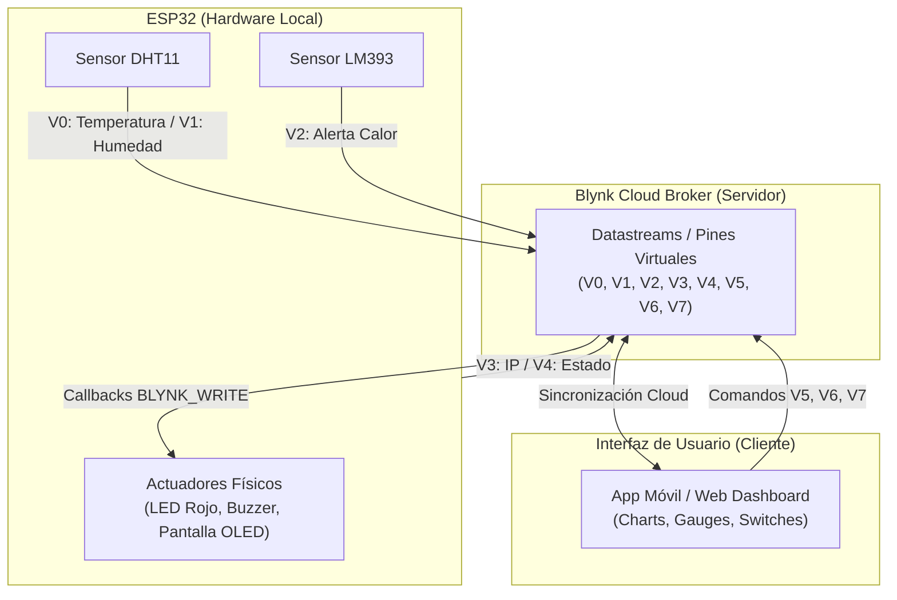
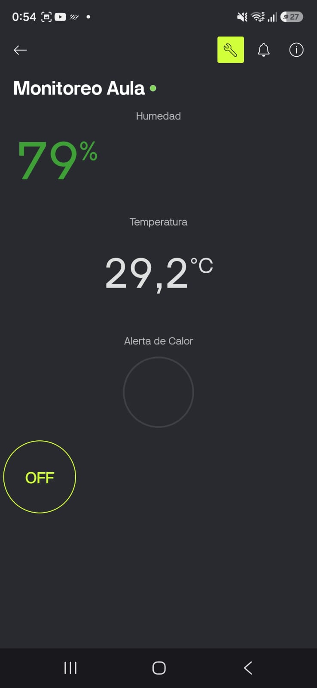
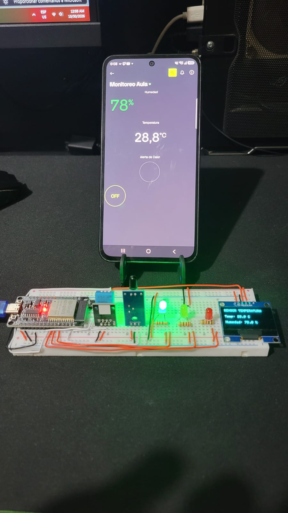

# Sistema IoT de Monitoreo Ambiental y Control Bidireccional

**Asignatura:** IoT (Internet de las Cosas)  
**Institución:** Unidades Tecnológicas de Santander (UTS)  
**Estudiante:** Juan Esteban Cárdenas López  
**Profesor:** Eliecer Montero  

---

## 📌 Descripción del Proyecto

Este proyecto implementa un sistema IoT bidireccional que recopila datos ambientales en tiempo real (Temperatura, Humedad y Alerta de Calor) mediante un microcontrolador **ESP32** y los transmite a la plataforma en la nube **Blynk IoT**. 

Adicionalmente, el sistema permite el **control remoto de actuadores** (LED Rojo, Buzzer sonoro y navegación en pantalla OLED SH1106) desde una aplicación móvil o un dashboard web, garantizando alta disponibilidad, baja latencia y reconexión automática mediante un portal cautivo WiFi (*WiFiManager*).

---

## 🏗️ Diagrama de Arquitectura

El flujo de información entre el hardware físico, la nube y los paneles de usuario se sintetiza en el siguiente esquema UML:



---

## 📋 Asignación de Pines Virtuales (Datastreams)

| Pin Virtual | Tipo de Dato | Dirección | Descripción / Componente Asociado |
| :--- | :--- | :--- | :--- |
| **V0** | Double / Float | ESP32 $\rightarrow$ Cloud | Lectura de Temperatura (°C) - Sensor DHT11 |
| **V1** | Double / Float | ESP32 $\rightarrow$ Cloud | Lectura de Humedad (%) - Sensor DHT11 |
| **V2** | Integer (0/1) | ESP32 $\rightarrow$ Cloud | Alerta de Calor / Radiación (0 = Normal, 1 = Calor) - LM393 |
| **V3** | String | ESP32 $\rightarrow$ Cloud | Dirección IP asignada en la red local |
| **V4** | String | ESP32 $\rightarrow$ Cloud | Estado de la conexión a Blynk Cloud |
| **V5** | Integer (0/1) | Cloud $\rightarrow$ ESP32 | Interruptor de control remoto para el **LED Rojo** |
| **V6** | Integer (0/1) | Cloud $\rightarrow$ ESP32 | Interruptor de control remoto para el **Buzzer** |
| **V7** | Integer (0/1) | Cloud $\rightarrow$ ESP32 | Botón virtual para **Rotar Pantalla OLED** |

---

## 🔌 Esquema de Conexiones de Hardware

Realiza las conexiones en la protoboard según la siguiente tabla de asignación de pines GPIO del ESP32:

| Componente | Pin del Componente | GPIO ESP32 |
| :--- | :--- | :--- |
| **DHT11** | DATA / OUT | `GPIO 23` |
| **LM393 (Calor)** | DO (Digital Out) | `GPIO 22` |
| **OLED SH1106** | SDA / SCL | `GPIO 4` (SDA) / `GPIO 5` (SCL) |
| **Push Button** | Pin Físico | `GPIO 17` (INPUT_PULLUP interno) |
| **LED Rojo** | Ánodo (+) | `GPIO 18` |
| **LED Amarillo** | Ánodo (+) | `GPIO 19` |
| **LED Verde** | Ánodo (+) | `GPIO 21` |
| **Buzzer Activo** | Positivo (+) | `GPIO 16` |

---

## 🚀 Instrucciones para Replicar el Proyecto

Sigue estos pasos en orden para montar y ejecutar el proyecto desde cero en cualquier entorno:

### Paso 1: Configuración de la Plataforma Cloud (Blynk IoT)

1. Ingresa a [blynk.cloud](https://blynk.cloud/) e inicia sesión con tu cuenta.
2. Ve a **Developer Zone** ➔ **Templates** ➔ **Create New Template**:
   * **Nombre:** `Alarma`
   * **Hardware:** `ESP32`
   * **Connection Type:** `WiFi`
3. Ve a la pestaña **Datastreams** y crea los 8 Pines Virtuales (`V0` a `V7`) según la tabla de asignación.
4. Ve a la pestaña **Web Dashboard** (o en la App Móvil) y arrastra los widgets:
   * **History Chart** ➔ Vinculado a `V0` (Temperatura).
   * **Gauge / Value Display** ➔ Vinculado a `V1` (Humedad).
   * **LED Widget / Color Block** ➔ Vinculado a `V2` (Calor).
   * **Switch** ➔ Vinculado a `V5` (LED Rojo).
   * **Switch** ➔ Vinculado a `V6` (Buzzer).
   * **Button (Modo PUSH)** ➔ Vinculado a `V7` (Navegación OLED).
   * **Labels / Text** ➔ Vinculados a `V3` (IP) y `V4` (Estado).
5. Ve a **Search** ➔ **Devices** ➔ **New Device** ➔ **From Template** y selecciona `Alarma`.
6. En la pestaña **Device Info**, copia las 3 líneas con el `BLYNK_TEMPLATE_ID`, `BLYNK_TEMPLATE_NAME` y `BLYNK_AUTH_TOKEN`.

---

### Paso 2: Configuración del Entorno en Arduino IDE

1. Abre el **Arduino IDE** e instala el soporte para placas ESP32 desde el *Board Manager*.
2. Ve a **Herramientas** ➔ **Administrar Bibliotecas** e instala las siguientes librerías:
   * `WiFiManager` (por tzapu)
   * `Blynk` (por Volodymyr Shymanskyy)
   * `DHT sensor library` (por Adafruit)
   * `Adafruit SH110X` y `Adafruit GFX Library`
3. Abre el archivo del proyecto `PROYECTOIOT.ino`.
4. En las primeras líneas del código, reemplaza las constantes con el Token de tu dispositivo obtenido en el Paso 1:
   ```cpp
   #define BLYNK_TEMPLATE_ID   "TMPL2YN-F-M4Y"
   #define BLYNK_TEMPLATE_NAME "Alarma"
   #define BLYNK_AUTH_TOKEN    "UtYj3HhSHoIrAXDtISwUVzEYqyDhH0ex"
   ```
5. Conecta el ESP32 a la PC mediante USB, selecciona la placa **ESP32 Dev Module**, escoge el puerto COM correspondiente y presiona **Subir** (Upload).

---

### Paso 3: Puesta en Marcha y Conexión de Red

1. Una vez grabado el programa, el ESP32 encenderá el **LED Amarillo** e iniciará la red WiFi de configuración llamada **`Alarma-Aula-Juanes`**.
2. Desde tu teléfono celular o PC, conéctate a la red WiFi **`Alarma-Aula-Juanes`**.
3. Se abrirá automáticamente el portal cautivo de *WiFiManager* (si no abre, ingresa desde el navegador a la IP `192.168.4.1`).
4. Selecciona **Configure WiFi**, busca la red WiFi de tu aula/hogar, ingresa la clave de red y presiona **Save**.
5. El ESP32 guardará los datos, se conectará a la red local, encenderá el **LED Verde** y pasará al estado **Online** en la consola de Blynk.

---

### Paso 4: Pruebas de Verificación

* **Telemetría:** Comprueba que los valores de temperatura y humedad se muestren en tiempo real en los widgets de la app.
* **Sensor de Calor:** Acerca una fuente de calor al sensor LM393 y verifica que el indicador cambie de `0` a `1` al instante.
* **Control Remoto:** Presiona los botones virtuales `V5` (LED Rojo), `V6` (Buzzer) y `V7` (Rotar OLED) desde tu celular y confirma la activación inmediata de los componentes físicos en el ESP32.

---

## 🧪 Pruebas de Integración y Resultados (Fase 3 y 4)

Se diseñó una interfaz móvil e hiperconectada orientada a la operación en tiempo real. La transmisión de eventos críticos (detección de calor con LM393) se ejecuta mediante la interrupción por cambio de estado, enviando inmediatamente la señal a Blynk sin depender del ciclo de muestreo.

* **PRUEBA 1: TELEMETRÍA Y PUBLICACIÓN**  
  **Resultado:** Exitoso. Las variables de humedad y temperatura se actualizan cada 2.5 segundos en la aplicación. El gráfico histórico (*History Chart*) almacena los registros sin pérdida de paquetes.

* **PRUEBA 2: CONTROL BIDIRECCIONAL**  
  **Resultado:** Exitoso. La activación de los switches para V5 (LED) y V6 (Buzzer) conmuta los pines físicos del ESP32 en menos de 150 ms. El botón virtual V7 rota la pantalla OLED en sincronía con el pulsador físico.

* **PRUEBA 3: SENSÓRICA INMEDIATA**  
  **Resultado:** Exitoso. Al acercar calor al LM393, la transición 0 $\rightarrow$ 1 conmuta instantáneamente en la aplicación y activa el indicador de alerta sin sufrir sofocamiento (*Rate Limit*).

* **PRUEBA 4: RESILIENCIA DE RED**  
  **Resultado:** Exitoso. Al desconectar la alimentación o apagar el router Wi-Fi, la app marca el estado Offline. Al restaurar la energía, WiFiManager y Blynk.config() reconectan automáticamente.

---

## 📸 Evidencias de Funcionamiento

### Demostración en Video
Puedes visualizar la demostración completa de control bidireccional y prueba de sensores en el siguiente enlace:

🎥 **[Ver Video de Demostración (MP4)](./desarrollo%20proyecto%20semana%2012/video_demostracion.mp4)**
> 📽️ **Nota:** El video completo con las pruebas de funcionamiento se encuentra adjunto localmente en la carpeta `/desarrollo proyecto semana 12/` del archivo comprimido del proyecto.


## 📸 Evidencias de Funcionamiento

### Captura del Dashboard de Blynk


### Foto del Circuito Físico del Proyecto

