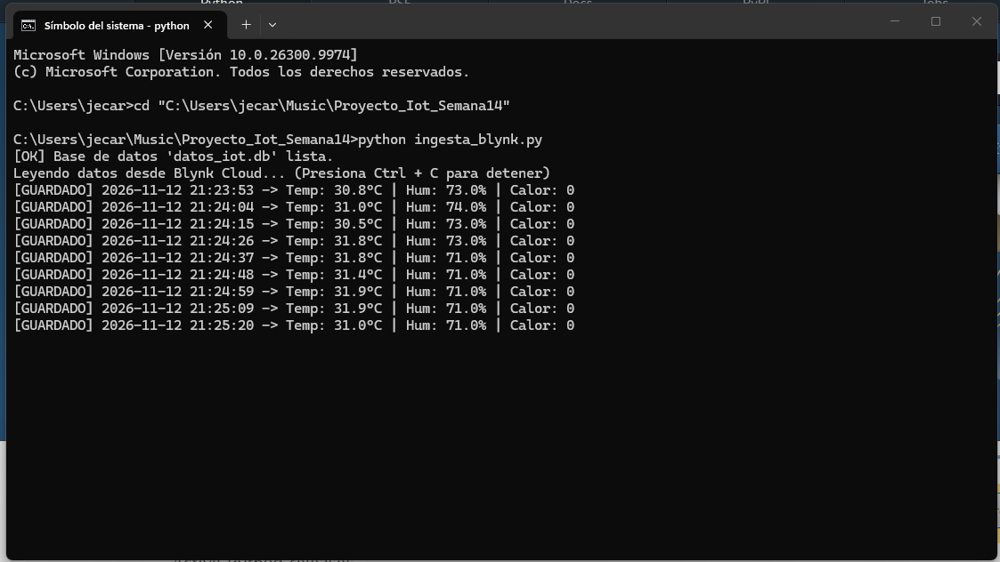

# 🌐 Sistema de Monitoreo Ambiental IoT y Persistencia de Datos

Este proyecto consiste en un sistema integral de telemetría IoT para la medición y monitoreo de variables ambientales (temperatura, humedad e indicador de calor) utilizando sensores físicos, la plataforma **Blynk Cloud** y una capa de almacenamiento local persistente con **Python** y **SQLite**.

---

## 📋 Tabla de Contenidos
- [📌 PARTE 1: Configuración Hardware y Conectividad IoT (Semana 12)](#-parte-1-configuración-hardware-y-conectividad-iot---semana-12)
- [📌 PARTE 2: Integración Blynk Cloud y Dashboard (Semana 13)](#-parte-2-integración-blynk-cloud-y-dashboard---semana-13)
- [📌 PARTE 3: Almacenamiento Avanzado y Persistencia Local (Semana 14)](#-parte-3-almacenamiento-avanzado-y-persistencia-local---semana-14)
- [🛠️ Requisitos e Instalación](#️-requisitos-e-instalación)
- [📷 Evidencias del Sistema](#-evidencias-del-sistema)

---

# 📌 PARTE 1: CONFIGURACIÓN HARDWARE Y CONECTIVIDAD IOT - SEMANA 12

## 🛠️ Componentes Utilizados
- **Microcontrolador:** ESP32 / ESP8266 con módulo Wi-Fi integrado.
- **Sensor de Temperatura y Humedad:** DHT11 (`Pin V0` / `Pin V1`).
- **Sensor de Detección de Calor:** LM393 o módulo digital equivalente (`Pin V2`).
- **Plataforma IoT:** Blynk IoT Cloud.

## 📐 Pines Virtuales Configurados
- `V0`: Temperatura (°C)
- `V1`: Humedad (%)
- `V2`: Estado de Calor (0 / 1)

---

# 📌 PARTE 2: INTEGRACIÓN BLYNK CLOUD Y DASHBOARD - SEMANA 13

## ☁️ Configuración en Blynk Cloud
Se configuró un Dashboard Web en **Blynk.console** con los siguientes widgets:
- **Gauge / Display Numérico:** Lectura de Temperatura en tiempo real (`V0`).
- **Gauge / Display Numérico:** Lectura de Humedad en tiempo real (`V1`).
- **LED / Indicator Status:** Alerta visual de alta temperatura / calor (`V2`).

## 📡 API REST de Blynk
El sistema utiliza la API pública de Blynk para consulta remota y extracción masiva de pines mediante peticiones HTTP GET:
```text
https://blynk.cloud/external/api/get?token=TU_TOKEN&V0&V1&V2
```

---

# 📌 PARTE 3: ALMACENAMIENTO AVANZADO Y PERSISTENCIA LOCAL - SEMANA 14

## 📌 Descripción del Proyecto (Semana 14)

En esta fase se extiende la arquitectura del sistema de monitoreo ambiental mediante la implementación de una capa de **almacenamiento avanzado y persistencia local**. Dado que el plan gratuito de **Blynk Cloud** limita el historial de datos a **24 horas**, se desarrolló una solución híbrida utilizando **Python** y **SQLite** (`datos_iot.db`).

El sistema extrae en tiempo real los valores de los pines virtuales (`V0`, `V1` y `V2`) mediante la API REST de Blynk en una única petición HTTP consolidada cada segundo, almacenándolos en disco duro con marca de tiempo exacta (`timestamp`). Esto garantiza retención ilimitada, independencia ante caídas de red tras la captura y capacidad de ejecutar consultas SQL analíticas.

---

## 🔄 Arquitectura de Persistencia Local

```text
[ Blynk Cloud REST API ] ──(GET /external/api/get?V0&V1&V2)──> [ ingesta_blynk.py ]
                                                                       │
                                                            (Inserción cada 1 seg)
                                                                       │
                                                                       ▼
[ Reportes Estadísticos ] <──(Consultas SQL: AVG/MAX/MIN)── [ datos_iot.db (SQLite) ]
       ▲                                                               │
       └────────────────────── [ verificar_datos.py ] ─────────────────┘
                            (Auditoría tras reinicio del PC)
```

---

## 🗄️ Esquema de Base de Datos (`datos_iot.db`)

Los registros recopilados se almacenan en la tabla relacional `historial_sensores` bajo la siguiente estructura:

| Campo | Tipo SQL | Restricción | Descripción |
| :--- | :--- | :--- | :--- |
| `id` | `INTEGER` | `PRIMARY KEY AUTOINCREMENT` | Identificador único y secuencial de cada lectura. |
| `fecha_hora` | `TEXT` | `NOT NULL` | Fecha y hora local de captura (`AAAA-MM-DD HH:MM:SS`). |
| `temperatura` | `REAL` | — | Temperatura ambiental capturada por el DHT11 (°C). |
| `humedad` | `REAL` | — | Humedad relativa ambiental capturada por el DHT11 (%). |
| `estado_calor` | `TEXT` | — | Estado lógico reportado por el sensor LM393 (`0` o `1`). |

---

## 🚀 Instrucciones de Ejecución en Servidor Local

1. Ubicar los archivos `ingesta_blynk.py`, `verificar_datos.py` y `datos_iot.db` dentro de la carpeta del proyecto.
2. Instalar la dependencia de consultas HTTP en Python:
   ```bash
   pip install requests
   ```
3. Iniciar la captura de telemetría en tiempo real:
   ```bash
   python ingesta_blynk.py
   ```
4. Ejecutar la auditoría de persistencia y resumen estadístico (incluso sin conexión a internet o tras reiniciar el equipo):
   ```bash
   python verificar_datos.py
   ```

---

## 💻 Scripts Desarrollados en Python

### 1. Script de Ingesta en Tiempo Real (`ingesta_blynk.py`)

```python
import sqlite3
import time
import requests
from datetime import datetime

BLYNK_TOKEN = "TOKEN_OCULTO_POR_SEGURIDAD"
BLYNK_SERVER = "blynk.cloud"
DB_ARCHIVO = "datos_iot.db"

def crear_base_datos():
    conexion = sqlite3.connect(DB_ARCHIVO)
    cursor = conexion.cursor()
    cursor.execute('''
        CREATE TABLE IF NOT EXISTS historial_sensores (
            id INTEGER PRIMARY KEY AUTOINCREMENT,
            fecha_hora TEXT NOT NULL,
            temperatura REAL,
            humedad REAL,
            estado_calor TEXT
        )
    ''')
    conexion.commit()
    conexion.close()
    print(f"[OK] Base de datos '{DB_ARCHIVO}' lista.")

def obtener_datos_tiempo_real():
    url = f"https://{BLYNK_SERVER}/external/api/get?token={BLYNK_TOKEN}&V0&V1&V2"
    try:
        resp = requests.get(url, timeout=3)
        if resp.status_code == 200:
            datos = resp.json()
            return datos.get("V0"), datos.get("V1"), datos.get("V2")
        return None, None, None
    except Exception:
        return None, None, None

def guardar_lectura(temp, hum, calor):
    conexion = sqlite3.connect(DB_ARCHIVO)
    cursor = conexion.cursor()
    ahora = datetime.now().strftime("%Y-%m-%d %H:%M:%S")
    cursor.execute('''
        INSERT INTO historial_sensores (fecha_hora, temperatura, humedad, estado_calor)
        VALUES (?, ?, ?, ?)
    ''', (ahora, temp, hum, calor))
    conexion.commit()
    conexion.close()
    print(f"[EN VIVO] {ahora} -> Temp: {temp}°C | Hum: {hum}% | Calor: {calor}")

if __name__ == "__main__":
    crear_base_datos()
    print("Capturando en tiempo real desde Blynk... (Ctrl + C para detener)")
    while True:
        t, h, c = obtener_datos_tiempo_real()
        if t is not None and h is not None:
            guardar_lectura(float(t), float(h), str(c) if c is not None else "0")
        time.sleep(1)
```

### 2. Script de Verificación de Persistencia (`verificar_datos.py`)

```python
import sqlite3

DB_ARCHIVO = "datos_iot.db"

def revisar_persistencia():
    conexion = sqlite3.connect(DB_ARCHIVO)
    cursor = conexion.cursor()
    
    cursor.execute("SELECT COUNT(*) FROM historial_sensores")
    total = cursor.fetchone()[0]
    print(f"\n==========================================")
    print(f"TOTAL DE REGISTROS PERSISTENTES EN DISCO: {total}")
    print(f"==========================================\n")
    
    if total > 0:
        cursor.execute('''
            SELECT 
                AVG(temperatura), MAX(temperatura), MIN(temperatura),
                AVG(humedad), MAX(humedad), MIN(humedad)
            FROM historial_sensores
        ''')
        prom_t, max_t, min_t, prom_h, max_h, min_h = cursor.fetchone()
        print(f"Resumen Temperatura -> Promedio: {prom_t:.2f}°C | Máxima: {max_t:.1f}°C | Mínima: {min_t:.1f}°C")
        print(f"Resumen Humedad     -> Promedio: {prom_h:.2f}%  | Máxima: {max_h:.1f}%  | Mínima: {min_h:.1f}%\n")
        
        print("Últimos 10 registros almacenados:")
        cursor.execute("SELECT * FROM historial_sensores ORDER BY id DESC LIMIT 10")
        for fila in cursor.fetchall():
            print(f"  ID: {fila[0]} | Fecha: {fila[1]} | Temp: {fila[2]}°C | Hum: {fila[3]}% | Calor: {fila[4]}")
            
    conexion.close()

if __name__ == "__main__":
    revisar_persistencia()
```

---

## 🖼️ Evidencias de Funcionamiento y Persistencia (Semana 14)

### Captura de Ingesta Activa en Tiempo Real (`ingesta_blynk.py`)


### Verificación de Persistencia tras Reinicio del Sistema (`verificar_datos.py`)
.png)

---

## 📝 Conclusiones sobre Persistencia Local en IoT

1. **Superación de Límites Cloud:** La integración de Python con SQLite desacopla el almacenamiento histórico respecto al límite de 24 horas del plan gratuito de Blynk Cloud, proporcionando retención indefinida en almacenamiento local.
2. **Persistencia Transaccional:** Las pruebas de reinicio completo del servidor local confirmaron la conservación íntegra de los registros en disco duro (`datos_iot.db`), habilitando auditorías y consultas estadísticas (`AVG`, `MAX`, `MIN`) sin depender de conectividad continua.
3. **Portabilidad y Eficiencia:** Al ser SQLite una base de datos autocontenida en un único archivo físico, permite migrar y auditar el histórico de telemetría en cualquier estación de trabajo sin configurar motores externos pesados.